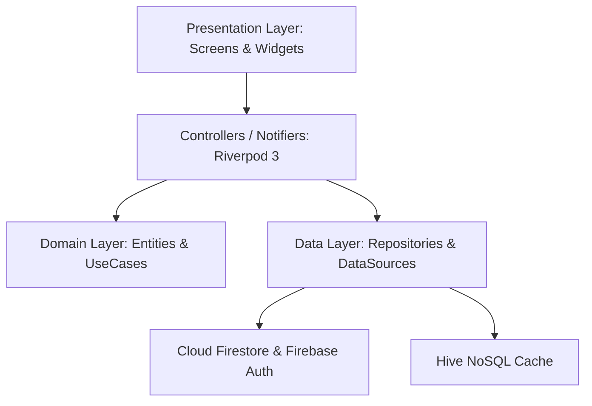

# 🎓 মেধাবী (Medhavi) Mobile

[](https://flutter.dev)
[](https://dart.dev)
[](https://riverpod.dev)
[](https://pub.dev/packages/go_router)
[-27ae60)](#-architecture--design-patterns)
[](https://firebase.google.com)
[](#)
[](LICENSE)

**মেধাবী (Medhavi)** হলো বিসিএস (Bangladesh Civil Service) ও সকল সরকারি চাকরি প্রত্যাশীদের জন্য একটি আধুনিক, স্মার্ট এবং উচ্চ ক্ষমতাসম্পন্ন ক্রস-প্ল্যাটফর্ম মোবাইল অ্যাপ্লিকেশন। 

অ্যাপটিতে রয়েছে **১০ম থেকে ৫০তম বিসিএস প্রিলিমিনারি পরীক্ষার ৫,৪২৩+ নির্ভুল প্রশ্ন ও বিস্তারিত ব্যাখ্যা**, গণিত ও বিজ্ঞানের জটিল ফর্মুলা প্রদর্শনের জন্য নেটিভ **KaTeX LaTeX** ইঞ্জিন, ইন্টারেক্টিভ সেলফ-টেস্টিং, এবং দুর্বলতা দূরীকরণে **ভুল ব্যাংক (Mistake Bank)** ও **বুকমার্ক** সিস্টেম।

---

## 🌟 প্রধান বৈশিষ্ঠ্যসমূহ (Key Features)

### 📚 ১. সম্পূর্ণ বিসিএস প্রশ্ন ব্যাংক (Authentic 10th–50th BCS)
- **১০ম থেকে ৫০তম বিসিএস** প্রিলিমিনারি পরীক্ষার শতভাগ প্রশ্ন ও স্ট্যান্ডার্ড উত্তর।
- **১০টি ক্যাটাগরি ফিল্টার**: বাংলা ভাষা ও সাহিত্য, ইংরেজি ভাষা ও সাহিত্য, বাংলাদেশ বিষয়াবলী, আন্তর্জাতিক বিষয়াবলী, সাধারণ বিজ্ঞান, কম্পিউটার ও তথ্যপ্রযুক্তি, গাণিতিক যুক্তি, মানসিক দক্ষতা, নৈতিকতা, মূল্যবোধ ও সুশাসন, এবং ভূগোল, পরিবেশ ও দুর্যোগ ব্যবস্থাপনা।
- **ব্যাচ ড্রপডাউন শিট**: এক ক্লিকে যেকোনো নির্দিষ্ট বিসিএস ব্যাচ ফিল্টার করার সুবিধা।
- **স্মার্ট সার্চ ও ফিল্টারিং**: প্রশ্নপত্র, ব্যাখ্যা ও ট্যাগের মধ্যে তাত্ক্ষণিক অনুসন্ধান।
- **মাস্টার রিভিল সুইচ (Eye / EyeOff)**: এক ক্লিকে সব প্রশ্নের উত্তর ও ব্যাখ্যা প্রদর্শন বা লুকানোর টগল।

### 🧮 ২. নেটিভ KaTeX LaTeX গণিত ও বিজ্ঞান সূত্র ইঞ্জিন
- কোনো ভারী ও ধীরগতির WebView ব্যবহার না করে সরাসরি Flutter Canvas-এ `flutter_math_fork`-এর মাধ্যমে জটিল সমীকরণ যেমন $a^2 - b^2$, $\frac{a}{b}$, $\sqrt{x}$, $\log_{10}(x)$, এবং রাসায়নিক সমীকরণ রেন্ডার হয়।
- টেক্সট ও ফর্মুলা একসাথে নিখুঁতভাবে ইনলাইন র‍্যাপ হয়।

### 🎯 ৩. সর্বজনীন `StudyQuestionCard` কম্পোনেন্ট
- **অপশন গ্রিড**: অপশনগুলোর পাশে বাংলা হরফ ব্যাজ `[ক, খ, গ, ঘ]`।
- **তুলনামূলক উত্তর বিশ্লেষণ (Comparative Banner)**:
  - ভুল উত্তর দিলে: `আপনার উত্তর: [ক] ✗` (রোজ/রেড ব্যাকগ্রাউন্ড)
  - সঠিক উত্তর: `সঠিক উত্তর: [খ] ✓` (এমারেল্ড/সবুজ ব্যাজ)
- **সেলফ-টেস্টিং মোড**: কোনো অপশনে ট্যাপ করলেই রিয়েল-টাইম হ্যাপটিক ফিডব্যাক সহ সঠিক ও ভুল অপশন হাইলাইট হয়ে যায় এবং স্বয়ংক্রিয়ভাবে বিস্তারিত ব্যাখ্যা ড্রয়ার খুলে যায়।
- **ধাপে ধাপে ব্যাখ্যা ড্রয়ার**: সম্পূর্ণ সমাধান ও সূত্রের বিস্তারিত ধাপ।
- **প্রশ্ন কপি ও বুকমার্ক**: সিঙ্গেল ট্যাপে সম্পূর্ণ প্রশ্ন ক্লিপবোর্ডে কপি করার সুবিধা।

### ❌ ৪. ভুল ব্যাংক (Mistake Bank)
- অনুশীলন ও পরীক্ষার সময় যে প্রশ্নগুলো ভুল হয়, সেগুলো স্বয়ংক্রিয়ভাবে ব্যবহারকারীর প্রোফাইলে ট্র্যাকিং হয়।
- পূর্বে দেওয়া ভুল উত্তরের সাথে সঠিক সমাধানের তুলনামূলক পর্যালোচনা।
- দুর্বলতা দূর হওয়ার পর ভুল তালিকা থেকে প্রশ্ন সরাসরি অপসরণের সুযোগ।

### 🔖 ৫. স্মার্ট বুকমার্কসমূহ (Bookmarks)
- যেকোনো গুরুত্বপূর্ণ প্রশ্ন এক ক্লিকে বুকমার্ক করে রাখা যায়।
- রিভিশন মোডে একনজরে গুরুত্বপূর্ণ প্রশ্নগুলো অনুশীলনের সুযোগ।

### ⚡ ৬. অনুশীলন হাব (Practice Hub)
- বিষয়ভিত্তিক কুইজ এবং কাস্টম অনুশীলনের জন্য সেন্ট্রাল হাব।
- প্রশ্ন ব্যাংকের ৫,৪২৩টি প্রশ্ন ছাড়াও বুকমার্ক এবং ভুল প্রশ্নের জন্য ডেডিকেটেড ড্রিল।

### 🌓 ৭. ম্যাটেরিয়াল ৩ ডার্ক ও লাইট থিম (Dynamic 3-Way Theme)
- লাইট (Light), ডার্ক (Dark) এবং সিস্টেম ডিফল্ট (System Default) থিম পরিবর্তন।
- হাইভ (Hive) লোকাল স্টোরেজে স্বয়ংক্রিয় সংরক্ষণ ও অ্যাপ রিস্টার্টেও স্টেট অপরিবর্তিত রাখা।
- চমৎকার বাংলা টাইপোগ্রাফির জন্য গুগলের **Hind Siliguri** ফন্ট ইন্টিগ্রেশন।

### 🌐 ৮. দ্বিভাষিক লোকালাইজেশন (Bangla & English Localization)
- বাংলা ও ইংরেজি ভাষার মধ্যে তাৎক্ষণিক সুইচের সুবিধা।
- পুরো অ্যাপের টেক্সট, বাটন ও নোটিফিকেশনে রিয়েলটাইম লোকালাইজেশন সমর্থন।

### 🏆 ৯. রিয়েল-টাইম লিডারবোর্ড (Leaderboard & 3D Podium)
- সাপ্তাহিক (Weekly), মাসিক (Monthly) এবং সর্বকালীন (All-Time) র‍্যাঙ্কিং ট্যাব।
- শীর্ষ ৩ জন মেধা অধিকারীর জন্য দৃষ্টিনন্দন **3D গোল্ড 🥇, সিলভার 🥈, ব্রোঞ্জ 🥉 পডিয়াম**।
- তালিকার নিচে পিন করা স্টিকি বারে ব্যবহারকারীর নিজস্ব বর্তমান র‍্যাঙ্ক, অর্জিত XP ও অবস্থান প্রদর্শন।

### 📊 ১০. পারফরম্যান্স অ্যানালিটিক্স (Detailed Analytics)
- ওভারঅল একুরেসি গেজ (Overall Accuracy Gauge)।
- ৪টি মূল মেট্রিক্স কার্ড: মোট উত্তর, সঠিক উত্তর, গড় গতি (সেকেন্ড/প্রশ্ন) এবং বর্তমান স্ট্রিক।
- সাপ্তাহিক স্টাডি ট্রেন্ড ভিউয়ালাইজেশন (সপ্তাহের প্রতিদিনের অনুশীলনের বার চার্ট)।
- ১০টি মূল বিসিএস বিষয়ের প্রতিটি বিষয়ের উপর পার্সেন্টেজ মাস্টারি প্রগ্রেস বার।

### ⏱️ ১১. লাইভ কুইজ ও মেগা মডেল টেস্ট (Live Quiz & Timed Drills)
- বাস্তবসম্মত বিসিএস পরীক্ষার মতো কাউন্টডাউন টাইমার।
- ৫ মিনিটের স্পিড ড্রিল ও ২০০ নম্বরের মেগা মডেল টেস্ট মডিউল।
- বিসিএস প্রিলির নেগেটিভ মার্কিং হিসাব (প্রতি ভুল উত্তরের জন্য -০.৫০ নম্বর কর্তন)।
- পরীক্ষা শেষে স্বয়ংক্রিয় অ্যানালিটিক্যাল স্কোরকার্ড রিভিউ মডাল (সঠিক, ভুল, স্কোর, সময় ও নির্ভুলতা বিশ্লেষণ)।

### 👤 ১২. প্রোফাইল ও টার্গেট ক্যাডার (User Profile)
- প্রোফাইল অ্যাভাটার, নাম ও টার্গেট বিসিএস ক্যাডার ব্যাজ (যেমন: BCS Administration / Police)।
- বিসিএস ব্যাচ ও কুইক প্রিফারেন্স টগল।

### ⚙️ ১৩. সেটিংস ও কাস্টমাইজেশন (App Settings)
- থিম মোড ও ভাষা চয়নকারী।
- টার্গেট বিসিএস ব্যাচ ড্রপডাউন (যেমন: ৪৭তম বা ৪৮তম বিসিএস)।
- KaTeX ম্যাথ অটো-রেন্ডার টগল ও হ্যাপটিক ভাইব্রেশন সুইচ।
- ক্যাশ ক্লিয়ার (Clear Cache) এবং ভার্সন ইনফো কার্ড।

---

## 🏗️ Architecture & Design Patterns

প্রজেক্টটি **Feature-First Clean Architecture** প্যাটার্ন মেনে তৈরি করা হয়েছে:



### লেয়ার বিভাজন:
1. **Core Layer (`lib/core/`)**:
   - `components/`: সর্বজনীন `StudyQuestionCard`, `KaTexMathText`
   - `constants/`: রঙের প্যালেট (`AppColors`)
   - `router/`: GoRouter কনফিগারেশন (`app_router.dart`)
   - `theme/`: লাইট ও ডার্ক থিম (`app_theme.dart`)
   - `utils/`: বাংলা সংখ্যা ও বিসিএস টাইটেল কনভার্টার (`bengali_numeral_converter.dart`)

2. **Feature Layer (`lib/features/`)**:
   - `question_bank/`: প্রশ্ন ব্যাংক ব্রাউজিং, পেজিনেশন ও ব্যাচ ফিল্টারিং
   - `bookmarks/`: বুকমার্ক ম্যানেজমেন্ট ও তুলনামূলক উত্তর ভিউ
   - `mistakes/`: ভুল ব্যাংক ট্র্যাকিং ও সমাধান ড্রিল
   - `practice/`: বিষয়ভিত্তিক অনুশীলন হাব
   - `home/`: ড্যাশবোর্ড, মেট্রিক্স ও কুইক লঞ্চার
   - `auth/`: ফায়ারবেস অটোমেটিক সেশন ও অ্যানোনিমাস লগইন

3. **Quota Protection ($0 / 0 BDT Budget)**:
   - Firebase Spark Free Tier কোটা সুরক্ষার জন্য কার্সর পেজিনেশন (`limit: 20`, `startAfterDocument`) এবং ৩০-আইটেম ব্যাচ চাঙ্কিং ব্যবহার করা হয়েছে।

---

## 📂 Directory Structure

```text
medhavi_mobile/
├── android/                        # Android নেটিভ কনফিগারেশন
├── ios/                            # iOS নেটিভ কনফিগারেশন
├── lib/
│   ├── core/
│   │   ├── components/
│   │   │   ├── katex_math_text.dart         # ক্যানভাস বেসড ম্যাথ রেন্ডারার
│   │   │   └── study_question_card.dart     # সর্বজনীন প্রশ্ন কার্ড কম্পোনেন্ট
│   │   ├── constants/
│   │   │   └── app_colors.dart              # সেন্ট্রাল কালার প্যালেট
│   │   ├── localization/
│   │   │   ├── app_strings.dart             # দ্বিভাষিক (বাংলা ও ইংরেজি) ডিকশনারি
│   │   │   └── locale_controller.dart       # রিঅ্যাক্টিভ লোকেল স্টেট কন্ট্রোলার
│   │   ├── router/
│   │   │   └── app_router.dart              # GoRouter কনফিগারেশন ও রুট ম্যাপ
│   │   ├── services/
│   │   │   └── preferences_service.dart     # Hive লোকাল ক্যাশ ও পারসিস্টেন্স
│   │   ├── theme/
│   │   │   ├── app_theme.dart               # Material 3 & Hind Siliguri থিম
│   │   │   └── theme_controller.dart        # ৩-ওয়ে থিম সুইচ কন্ট্রোলার
│   │   └── utils/
│   │       └── bengali_numeral_converter.dart # বাংলা সংখ্যা কনভার্টার
│   ├── features/
│   │   ├── analytics/
│   │   │   ├── presentation/controllers/analytics_controller.dart
│   │   │   └── presentation/screens/analytics_screen.dart # প্রগ্রেস ও ট্রেন্ড
│   │   ├── auth/
│   │   │   ├── presentation/controllers/auth_controller.dart
│   │   │   └── presentation/screens/
│   │   │       ├── login_screen.dart        # আধুনিক লগইন ও পাসওয়ার্ড রিকভারি
│   │   │       └── register_screen.dart     # পূর্ণ নাম ও ভ্যালিডেশন সহ রেজিস্ট্রেশন
│   │   ├── bookmarks/
│   │   │   ├── data/datasources/bookmarks_remote_datasource.dart
│   │   │   ├── presentation/controllers/bookmarks_controller.dart
│   │   │   └── presentation/screens/bookmarks_screen.dart
│   │   ├── home/
│   │   │   └── presentation/screens/home_dashboard_screen.dart
│   │   ├── leaderboard/
│   │   │   ├── domain/entities/leaderboard_entry.dart
│   │   │   ├── presentation/controllers/leaderboard_controller.dart
│   │   │   └── presentation/screens/leaderboard_screen.dart # 3D পডিয়াম ও র‍্যাঙ্ক
│   │   ├── live_quiz/
│   │   │   ├── presentation/controllers/live_quiz_controller.dart
│   │   │   └── presentation/screens/
│   │   │       ├── live_quiz_hub_screen.dart  # লাইভ টেস্ট হাব ও স্পিড ড্রিল
│   │   │       └── active_quiz_screen.dart    # টাইমার, নেগেটিভ মার্কিং ও স্কোরকার্ড
│   │   ├── mistakes/
│   │   │   ├── data/datasources/mistakes_remote_datasource.dart
│   │   │   ├── presentation/controllers/mistakes_controller.dart
│   │   │   └── presentation/screens/mistake_bank_screen.dart
│   │   ├── practice/
│   │   │   └── presentation/screens/practice_hub_screen.dart
│   │   ├── profile/
│   │   │   └── presentation/screens/profile_screen.dart   # ইউজার প্রোফাইল ও টার্গেট
│   │   ├── question_bank/
│   │   │   ├── data/datasources/question_remote_datasource.dart
│   │   │   ├── domain/entities/question_entity.dart
│   │   │   ├── presentation/controllers/question_bank_controller.dart
│   │   │   └── presentation/screens/question_bank_screen.dart
│   │   ├── settings/
│   │   │   └── presentation/screens/settings_screen.dart  # থিম, ল্যাঙ্গুয়েজ ও প্রিফারেন্স
│   │   └── shell/
│   │       └── presentation/screens/app_shell_scaffold.dart
│   ├── firebase_options.dart       # ফায়ারবেস কনফিগারেশন
│   └── main.dart                   # অ্যাপলিকেশন এন্ট্রি পয়েন্ট
├── test/
│   └── widget_test.dart            # ইউনিট, লোকালাইজেশন ও স্কোরিং টেস্ট
├── pubspec.yaml                    # ডিপেন্ডেন্সি ও প্যাকেজ ম্যানিফেস্ট
└── README.md                       # বিস্তারিত ডকুমেন্টেশন
```

---

## 🛠️ Tech Stack & Dependencies

| প্যাকেজ | সংস্করণ | উদ্দেশ্য |
| :--- | :--- | :--- |
| **flutter_riverpod** | `^3.3.2` | ক্লিন নোটিফায়ার স্টেট ম্যানেজমেন্ট |
| **go_router** | `^17.0.0` | ডিক্লেয়ারেটিভ রাউটিং ও পারসিস্টেন্ট ন্যাভিগেশন বার |
| **cloud_firestore** | `^7.0.0` | রিয়েল-টাইম ক্লাউড ডেটাবেস |
| **firebase_auth** | `^7.0.0` | ইউজার অথেন্টিকেশন ও পারসোনালাইজড ট্র্যাকিং |
| **flutter_math_fork**| `^0.7.4` | নেটিভ KaTeX LaTeX ক্যানভাস রেন্ডারিং |
| **google_fonts** | `^6.3.2` | Hind Siliguri বাংলা ফন্ট |
| **hive_flutter** | `^1.1.0` | অফলাইন ফাস্ট নো-এসকিউএল ক্যাশিং |
| **lucide_icons_flutter** | `^4.0.0` | আধুনিক ও পরিচ্ছন্ন ভেক্টর আইকন |
| **intl** | `^0.20.2` | সংখ্যা ও তারিখ ফরম্যাটিং |

---

## 🚀 Getting Started (রান করার নির্দেশিকা)

### পূর্বশর্ত (Prerequisites):
- [Flutter SDK](https://docs.flutter.dev/get-started/install) (`>= 3.32.0`)
- [Dart SDK](https://dart.dev/get-dart) (`>= 3.8.0`)
- Android Studio / VS Code (Flutter & Dart প্লাগিন সহ)
- Android SDK (API 34+) বা ফিজিক্যাল অ্যান্ড্রয়েড/আইওএস ডিভাইস

### ১. রিপোজিটরি ক্লোন করুন
```bash
git clone https://github.com/bilash-biswas/medhavi-mobile.git
cd medhavi-mobile
```

### ২. ডিপেন্ডেন্সি ইন্সটল করুন
```bash
flutter pub get
```

### ৩. স্ট্যাটিক অ্যানালাইসিস চালান
```bash
flutter analyze
```
*(০টি এরর ও ০টি ওয়ার্নিং নিশ্চিত করা আছে)*

### ৪. ইউনিট টেস্ট চালান
```bash
flutter test
```

### ৫. অ্যাপ রান করুন
```bash
# অ্যান্ড্রয়েড ডিভাইস বা এমুলেটরে রান করতে:
flutter run

# নির্দিষ্ট ডিভাইসে রান করতে:
flutter run -d chrome      # ওয়েব প্রিভিউ
flutter run -d <device_id> # ফিজিক্যাল ডিভাইস
```

---

## 🗄️ Firestore Database Schema

অ্যাপটি ক্লাউড ফায়ারবেসের সাথে সরাসরি সংযুক্ত:

```text
/questions/{questionId}
  ├── examId: "exam_bcs"
  ├── subjectId: "bcs_bangla" | "bcs_math" | "bcs_english" ...
  ├── question: "যদি $a + b = 5$ হয়..."
  ├── options: [{ id: "a", text: "..." }, { id: "b", text: "..." }]
  ├── correctOptionId: "a"
  ├── explanation: "বিস্তারিত সমাধান..."
  ├── difficulty: "easy" | "medium" | "hard"
  ├── source: "46th-bcs"
  ├── tags: ["46th-bcs", "algebra"]
  └── createdAt: Timestamp

/users/{uid}/bookmarks/{questionId}
  ├── questionId: string
  ├── selectedOptionId: string (ঐচ্ছিক - শেষ প্রদত্ত উত্তর)
  └── createdAt: Timestamp

/users/{uid}/questionStats/{questionId}
  ├── selectedOptionId: string
  ├── isCorrect: boolean
  ├── incorrectCount: number
  └── lastAttemptedAt: Timestamp
```

---

## 🤝 Contributing

যেকোনো বাগ রিপোর্ট, ফিচার রিকোয়েস্ট বা কন্ট্রিবিউশনের জন্য Pull Request আহ্বান জানানো হচ্ছে:

1. রিপোজিটরিটি Fork করুন
2. নতুন ফিচার ব্রাঞ্চ তৈরি করুন (`git checkout -b feature/amazing-feature`)
3. পরিবর্তন কমিট করুন (`git commit -m 'feat: Add amazing feature'`)
4. ব্রাঞ্চে পুশ করুন (`git push origin feature/amazing-feature`)
5. একটি Pull Request ওপেন করুন

---

## 📄 License

প্রজেক্টটি **MIT License** এর আওতাভুক্ত। বিস্তারিত জানতে [LICENSE](LICENSE) ফাইল দেখুন।

---

<p align="center">
  তৈরি করেছে <b>বিলাশ কুমার বিশ্বাস</b> ❤️ <b>মেধাবী (Medhavi)</b> টিম
</p>
